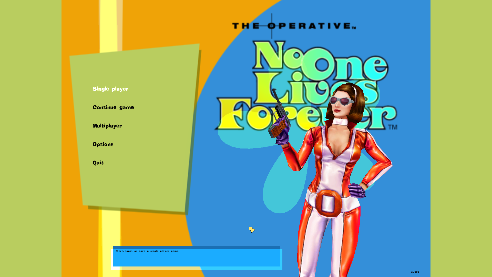
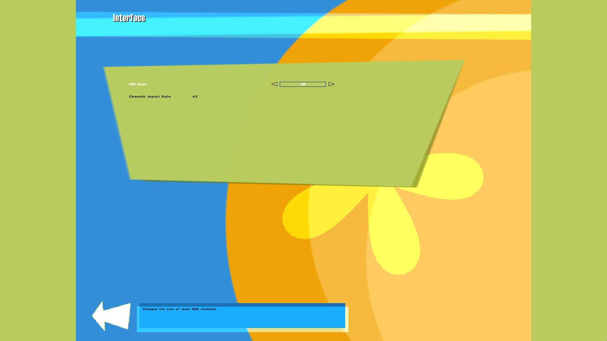
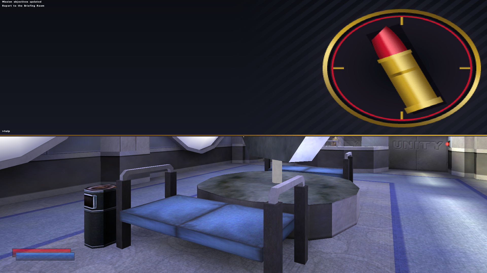
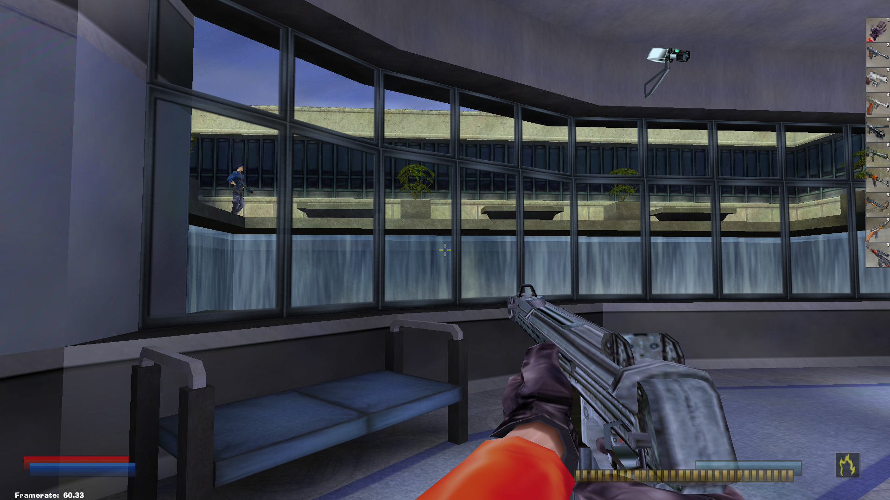

# NOLF Retro Modernizer

A free modernization patch for **No One Lives Forever** (NOLF) that runs on
legacy systems such as **Windows 98 SE and Windows XP**. On modern Windows,
the [NOLF Modernizer](https://github.com/haekb/nolf1-modernizer) is the better
choice.

The patch adds widescreen resolutions, a scaled menu and HUD, and new features
such as a console.

**Creator:** Alexander Schmidt, <alex-286@web.de>

**Version:** 0.9 (first release)

*This add-on is not made by or supported by Monolith Productions, or any of its
affiliates and subsidiaries.*

> **Status:** version 0.9 is the first public release. Download it from the
> [Releases](../../releases) page. Please report problems via
> [Issues](../../issues).

**Contents:** [Requirements](#requirements) · [Installation](#installation) ·
[Screenshots](#screenshots) · [Features](#features) ·
[Settings and console commands](#settings-and-console-commands) ·
[Not included](#not-included) · [Troubleshooting](#troubleshooting) ·
[Credits](#credits) · [Legal](#legal)

## About this repository

This repository only hosts the **binary releases** and the user documentation
of the patch. The source code is not published here: it is derived from the
NOLF Source Code v1.003, whose license (EULA) does not allow redistributing the
source. See [LICENSE.md](LICENSE.md).

## Requirements

- A licensed copy of No One Lives Forever 1, patched to version 1.003. The
  patch contains no game assets and does not replace the game.
- Windows 98 SE, Windows XP, or newer (tested on Windows 98 SE, XP and 10/11).
- The patch may also work with version 1.004, but this is untested.

## Installation

The patch is a single file, `NOLF-RETRO-MODERNIZER.REZ`. The original
`NOLF.REZ` and `NOLF2.REZ` are never modified, so you can remove the patch at
any time.

1. Download `NOLF-RETRO-MODERNIZER.REZ` from the latest
   [release](../../releases).
2. Copy it into your NOLF game folder, the one that contains `NOLF.exe`, for
   example `C:\Games\NOLF\NOLF-RETRO-MODERNIZER.REZ`.
3. Start the NOLF Launcher and click **Advanced...**. Add the following to
   the end of the **Command line** field and keep the entries that are already
   there:

   ```text
   -rez NOLF-RETRO-MODERNIZER.REZ
   ```

   Enable **Always specify these command line parameters** and click **OK**.
4. Click **Start**. The opening screen shows
   *NOLF Retro Modernizer v0.9* when the patch is loaded.
5. In the game, choose a widescreen resolution under **Options → Display**.

If you start `NOLF.exe` yourself instead of using the Launcher, pass the same
parameters on the command line.

**Updating:** replace the file with the newer version.

**Uninstalling:** remove `-rez NOLF-RETRO-MODERNIZER.REZ` from the Launcher's
command line and delete the file. No original game file is changed.

## Screenshots

| Main menu | Interface options |
| --- | --- |
|  |  |

| Console | Widescreen gameplay |
| --- | --- |
|  |  |

## Features

### Widescreen

| Feature | Original NOLF | This patch |
| --- | --- | --- |
| Resolutions | Only 4:3 modes | Widescreen modes such as 1920x1080 are selectable |
| Menus | Stretched to the full screen | Centered 640x480 canvas scaled to the screen height; the areas beside it are shaded. 3D menu models and backdrops stay aligned |
| Menu arrows | Fixed-size bitmaps | Scaled Back/Continue arrows with matching mouse hit-testing |
| HUD, crosshairs, loading screens | Fixed 4:3 layout | Scaled for the current resolution; the interface refreshes after a resolution change |
| Cinematics | 4:3 only | Wide by default, or black side bars to keep 4:3 (option in the Interface menu) |
| Sniper scope | World visible beside the scope mask | Black side bars around the scope mask, also when zooming with the sunglasses |

### Options and tools

| Feature | Original NOLF | This patch |
| --- | --- | --- |
| Interface options | Not present | New **Interface** folder with a HUD scale slider (`UIScale`) and a cinematic aspect ratio toggle (`RestrictCinematicsTo4x3`) |
| Framerate cap | Uncapped | 60 fps in menus and gameplay (`FramerateLock`, default on; always on in multiplayer) |
| FPS counter | Not present | Bottom-left "Framerate" display (`ShowFramerate`, default off) |
| Console | Not present | Opens with **Shift+Esc**, or with a key you bind under *Customize Controls → Toggle Console*; backdrop selectable with `ConsoleBackdrop` |
| Popup text | Closed with Escape or the activate key | Can also be closed with the right mouse button |
| Ammo selection | Always switches to the best ammo type | Remembers the last used ammo type per weapon (until the game is restarted) and falls back to the best ammo when it runs out |

## Settings and console commands

Enter these in the console, or set them in `autoexec.cfg`.

| Command | Type | Description | Default |
| --- | --- | --- | --- |
| `FramerateLock` | INT | `1` locks the framerate to 60 fps | `1` |
| `ShowFramerate` | INT | `1` displays the framerate | `0` |
| `RestrictCinematicsTo4x3` | INT | `1` adds black bars to cinematics on non-4:3 resolutions | `0` |
| `UIScale` | FLOAT | Scales the in-game HUD | `0.5` |
| `ConsoleBackdrop` | INT | Console backdrop: `0` the patch's own image, `1` the game's blank tag, `2` solid black | `0` |

`RestrictCinematicsTo4x3` and `UIScale` are also available in the **Interface**
options menu. `FramerateLock` is always active in multiplayer.

### Console

- **Shift+Esc** opens the console; **Esc** closes it. To use a dedicated key,
  open **Customize Controls**, scroll to the last entry (**Toggle Console**)
  and bind a key such as the tilde/backtick key. The retail game has no
  default binding.
- `Help` lists the available commands, `Cheats` lists the cheat codes, and
  `WriteToDebugLog` appends the console history to the debug log.
- Commands run on the client only. Server-side console programs are not
  available, because the retail `Object.lto` does not support them.
- The console is disabled in multiplayer.

## Not included

This patch changes only the client side of the game. The following are not
part of it:

- Server-side changes, including the NOLF Modernizer's server-side framerate
  lock.
- The Modernizer's "Lock Framerate" and "Display Framerate" menu options (the
  patch uses the `FramerateLock` and `ShowFramerate` commands instead).
- The other Modernizer commands: `OldMouseLook`, `NoFunMenus`, `QuickSwitch`,
  `UseGotyMenu`, `NoRawInput`, `BigHeadMode`, `DisplayTriggers`,
  `EnableScreenTinting` and `EnableLightScale`.
- Game assets. The patch does not replace or modify any of the game's own
  files.

## Troubleshooting

- **No widescreen resolutions or no version on the opening screen:** the rez
  file is not loaded. Open the Launcher's **Advanced...** dialog and check
  that the **Command line** contains `-rez NOLF-RETRO-MODERNIZER.REZ`, that
  the file name matches the file in the game folder, and that **Always
  specify these command line parameters** is enabled.
- **Debug log:** the patch writes `RetroDebug.log` into the game's working
  directory, and the file is overwritten on every launch. Please attach it to
  bug reports, together with your Windows version and resolution.

## Credits

Several features follow the behavior of the
[NOLF Modernizer](https://github.com/haekb/nolf1-modernizer) by its authors,
re-implemented for Visual C++ 2005 and legacy Windows: the framerate cap, FPS
counter and console. The Shift+Esc console
shortcut, right-click popup closing, per-weapon ammo memory and the scope
borders for sunglasses zoom are taken from its
[pull request #55](https://github.com/haekb/nolf1-modernizer/pull/55). NOLF
is a trademark of its respective owners (Monolith Productions / Warner Bros.).

## Legal

This patch is a free *Variation* in the sense of the *NOLF Source Code v1.003
EULA*. It is and stays free of charge and works only with a full copy of NOLF.
See [LICENSE.md](LICENSE.md) for the terms of use and redistribution.
